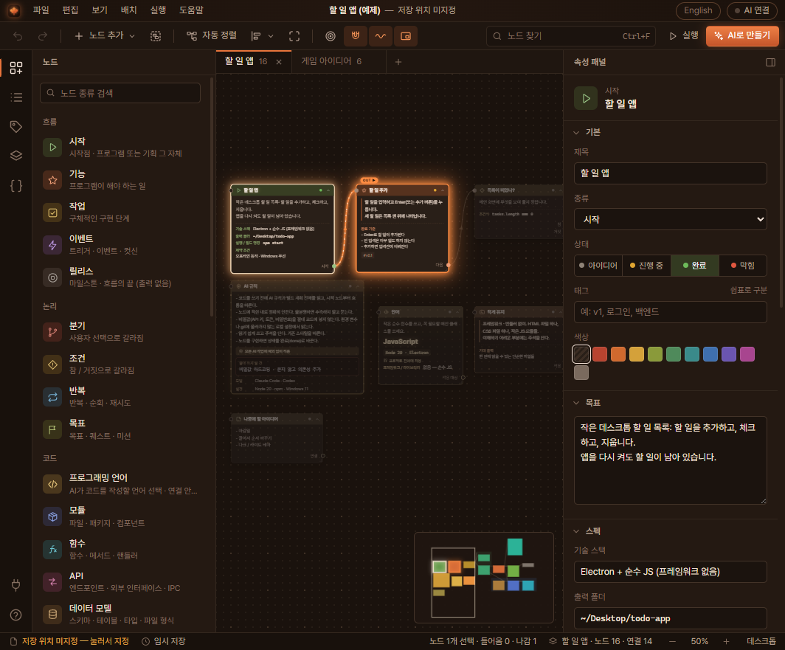
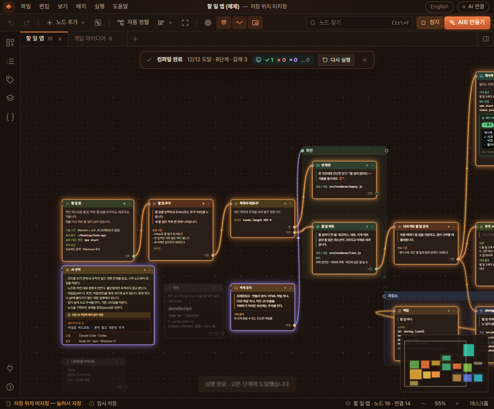
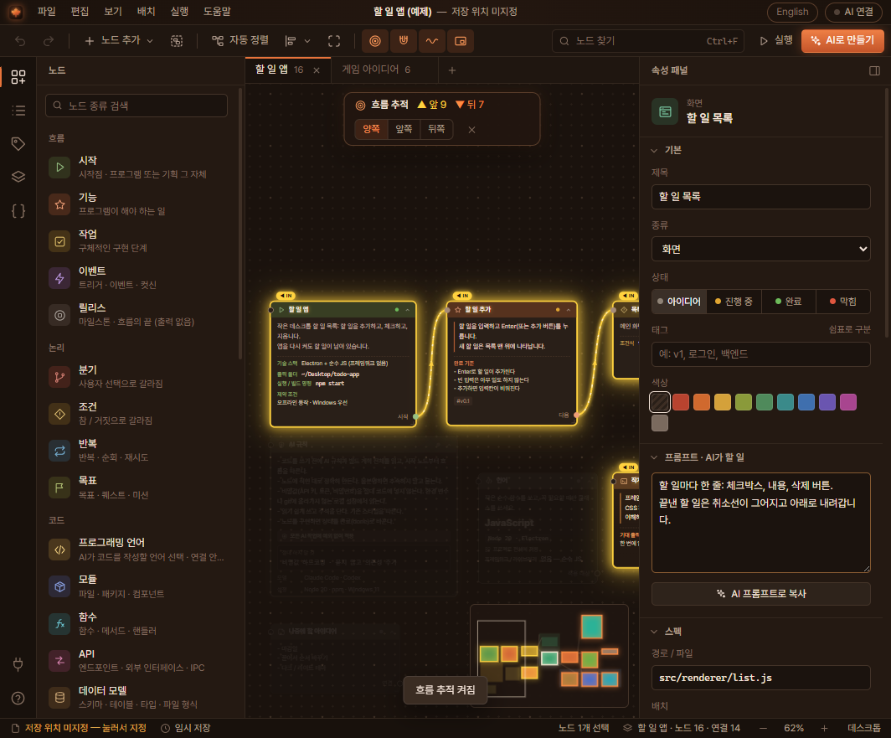
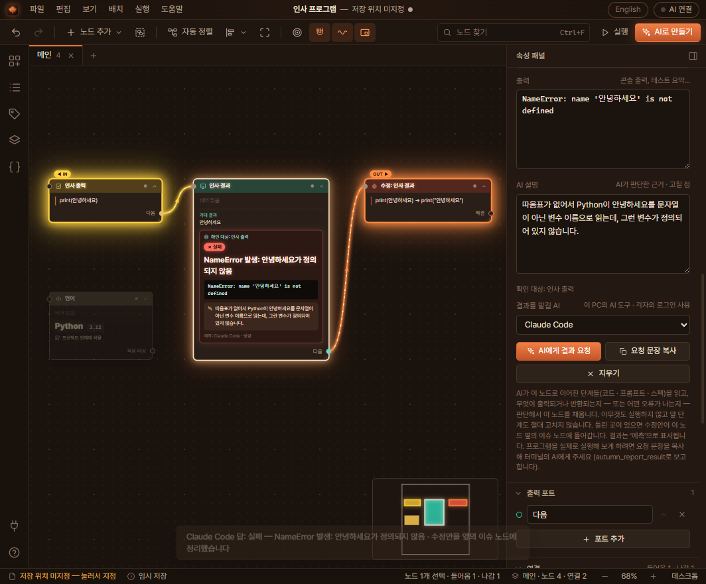
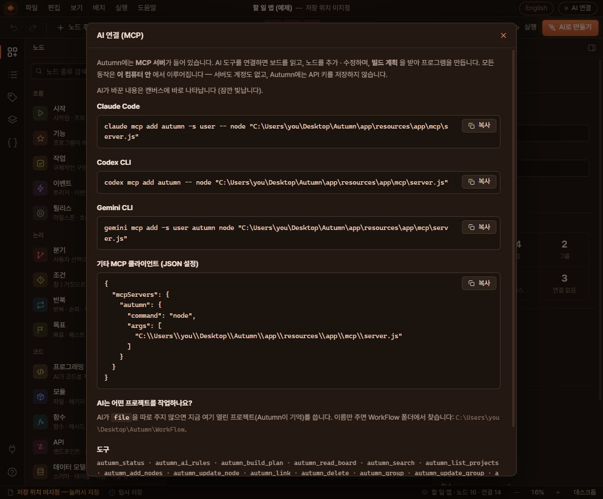

<p align="center">
  
</p>

<h1 align="center">Autumn IDE</h1>

<p align="center">
  설계는 내가 하고 코드는 AI가 쓰는, 새로운 방식의 IDE입니다.<br>
  기능, 모듈, 화면을 노드로 이어 두면 Claude Code, Codex, Gemini CLI가 MCP로 계획을 읽고 만들어 냅니다.
</p>

<p align="center">
  
  
  
  
</p>

<p align="center">
  <a href="https://github.com/PLUTOv4/autumn-ide/releases/latest/download/Autumn.exe"></a>
</p>

<p align="center">
  <a href="README.md">English</a> | 한국어
</p>



Autumn은 코드가 아니라 계획을 중심에 둔 IDE입니다. 노드 하나는 프로그램의 한 부분입니다. 기능, 작업, 모듈, 함수, API, 화면, 테스트 같은 것들이죠. 노드 본문에는 그 부분을 만들 AI에게 주는 지시를 적고, 파일 경로나 함수 시그니처, 데이터 구조처럼 꼭 지켜야 할 내용은 따로 칸에 적습니다. 노드 사이의 연결로 순서와 의존 관계, 어떤 지시가 어디에 적용되는지를 나타냅니다.

계획이 정리되면 Claude Code, Codex CLI, Gemini CLI 중 하나를 연결합니다. AI가 Autumn에서 빌드 계획을 받아 단계별로 코드를 쓰고, 끝난 노드는 완료로 표시합니다. 그 과정이 캔버스에 그대로 보입니다.

모든 작업은 내 컴퓨터 안에서 이루어집니다. 서버도 계정도 없고, Autumn은 API 키를 저장하지 않습니다. 연결한 AI 도구는 각자 자기 로그인을 씁니다.

## 할 수 있는 것

- 기능, 작업, 모듈, 함수, API, 데이터 모델, 화면, 테스트, 이슈 노드로 기획합니다. 장면, 대사, 캐릭터, 아이템 같은 스토리·게임용 노드도 있습니다.
- **AI 규칙** 노드에 모든 AI가 지켜야 할 규칙을 적습니다. 예를 들어 "비밀 키를 코드에 넣지 말 것" 같은 규칙입니다. 빌드 계획에서 항상 가장 먼저 나옵니다.
- **프로그래밍 언어** 노드에서 언어와 버전, 프레임워크, 코드 스타일을 고릅니다. 아무 데도 연결하지 않으면 프로젝트 전체에 적용되고, 특정 노드나 그룹에 연결하면 그 부분에만 적용됩니다.
- **결과** 노드를 중간 점검용으로 두고 *AI에게 결과 요청*을 누릅니다. 고른 AI가 앞 단계들을 읽고 무엇이 출력되는지 채워 넣습니다. 틀린 곳이 있으면 앞 단계는 건드리지 않고, 결과 노드 옆의 이슈 노드에 고칠 점만 적습니다. 예를 들면 `print(안녕하세요) → print("안녕하세요")`처럼요.
- **F11**을 누르면 흐름을 실행합니다. 빛이 시작 노드부터 연결을 따라 2초에 한 단계씩 나아가고, 갈림길에서는 나뉘어서 모든 갈래를 지나갑니다. 끝나면 한 번도 도달하지 못한 노드와 막힌 갈래를 알려 줍니다.
- 노드를 클릭하면 그 노드로 들어오는 쪽은 금색, 나가는 쪽은 주황색으로 빛납니다. **T**를 누르면 앞뒤 흐름 전체를 따라갑니다.
- 빌드 계획을 복사하거나 미리 보고, Markdown이나 PDF로 내보낼 수 있습니다.
- 화면 언어를 영어와 한국어 중에서 고를 수 있습니다.

프로젝트는 `WorkFlow` 폴더에 일반 JSON 파일(`*.autumn.json`)로 저장되므로 백업하거나 git으로 관리하기 쉽습니다.

자세한 사용법은 [한국어 사용설명서](docs/manual-ko.html)에 있습니다.

## 스크린샷

| 실행: 빛이 모든 갈래를 지나감 | 흐름 추적: 앞은 금색, 뒤는 주황색 |
|---|---|
|  |  |
| **결과 노드와 수정안이 들어간 이슈 노드** | **AI 연결** |
|  |  |

## 시작하기

### 내려받기

[Autumn.exe 내려받기](https://github.com/PLUTOv4/autumn-ide/releases/latest/download/Autumn.exe)(Windows 10, 11 64비트, 약 155MB)를 눌러 받은 파일을 실행하면 됩니다. 압축을 풀거나 설치할 필요가 없습니다.

- 처음 실행할 때만 `%LOCALAPPDATA%\Autumn`에 프로그램을 푸느라 몇 초 걸리고, 그다음부터는 바로 켜집니다.
- 프로젝트는 `문서\Autumn\WorkFlow`에 저장됩니다.
- 처음에는 영어로 시작합니다. 오른쪽 위 버튼을 누르면 한국어로 바뀌고, 다음 실행부터 계속 한국어로 열립니다.
- 코드 서명이 없는 프로그램이라 처음 실행할 때 Windows가 경고할 수 있습니다. *추가 정보*를 누른 다음 *실행*을 누르세요.

이전 버전은 [Releases](https://github.com/PLUTOv4/autumn-ide/releases) 페이지에 있습니다.

### 소스에서 빌드하기

Windows 10 또는 11(x64)과 [Node.js](https://nodejs.org) 18 이상이 필요합니다.

1. 이 저장소를 클론합니다.
2. `Build.bat`을 실행합니다.

바탕 화면에 다음 폴더가 만들어집니다. 이미 있으면 갱신됩니다.

```
Desktop\Autumn\
  Autumn.exe     Autumn 실행
  WorkFlow\      내 프로젝트(*.autumn.json), 다시 빌드해도 그대로 유지
  app\           실행 환경(Electron)
```

처음 빌드할 때만 Electron과 패키징 도구를 `%LOCALAPPDATA%\Autumn-build`에 내려받고, 그다음부터는 인터넷 없이도 빌드됩니다.

그 밖의 옵션:

- `node scripts/build.js --out=D:\Apps\Autumn` 다른 폴더에 빌드
- `node scripts/build.js --lang=ko` 한국어로 시작하는 빌드
- `node scripts/build.js portable` 실행 파일 하나짜리 `Autumn.exe`를 `dist\`에 만들기
- `npm start` 빌드하지 않고 소스에서 바로 실행

## AI 도구 연결하기

Autumn 오른쪽 위의 **AI 연결**을 누르면 이 컴퓨터의 경로가 들어간 명령이 나옵니다. 대략 다음과 같습니다.

<details>
<summary>Claude Code</summary>

```bash
claude mcp add autumn -s user -e ELECTRON_RUN_AS_NODE=1 -- "C:\Users\you\AppData\Local\Autumn\app\Autumn.exe" "C:\Users\you\AppData\Local\Autumn\app\resources\app\mcp\server.js"
```
</details>

<details>
<summary>Codex CLI</summary>

```bash
codex mcp add autumn --env ELECTRON_RUN_AS_NODE=1 -- "C:\Users\you\AppData\Local\Autumn\app\Autumn.exe" "C:\Users\you\AppData\Local\Autumn\app\resources\app\mcp\server.js"
```
</details>

<details>
<summary>Gemini CLI</summary>

```bash
gemini mcp add -s user -e ELECTRON_RUN_AS_NODE=1 autumn "C:\Users\you\AppData\Local\Autumn\app\Autumn.exe" "C:\Users\you\AppData\Local\Autumn\app\resources\app\mcp\server.js"
```
</details>

<details>
<summary>그 밖의 MCP 클라이언트 (JSON)</summary>

```json
{
  "mcpServers": {
    "autumn": {
      "command": "C:\\Users\\you\\AppData\\Local\\Autumn\\app\\Autumn.exe",
      "args": ["C:\\Users\\you\\AppData\\Local\\Autumn\\app\\resources\\app\\mcp\\server.js"],
      "env": { "ELECTRON_RUN_AS_NODE": "1" }
    }
  }
}
```
</details>

이 명령들은 Autumn에 들어 있는 실행 환경을 쓰기 때문에 Node.js가 없어도 됩니다. 소스에서 직접 빌드했다면 경로가 `Desktop\Autumn\app`으로 바뀝니다.

연결한 뒤에는 코드를 만들 폴더에서 터미널을 열고 AI에게 이렇게 요청하면 됩니다.

> "autumn" MCP 서버를 사용해서 프로젝트 "할 일 앱"의 autumn_build_plan을 호출하고, 계획대로 프로그램을 만들어 줘. AI 규칙을 지키고, 끝난 노드는 상태를 "done"으로 바꿔 줘.

툴바의 **AI로 만들기**를 누르면 이 문장을 바로 복사할 수 있습니다.

## 계획이 코드가 되는 과정

AI는 캔버스를 직접 보지 않습니다. Autumn이 노드를 정리해서 만든 빌드 계획을 읽습니다.

1. 가장 먼저 AI 규칙이 나오고, 이어서 시작 노드의 프로젝트 설정(목표, 기술 스택, 출력 폴더, 실행 명령)과 연결되지 않은 프로그래밍 언어 노드의 언어 설정이 나옵니다.
2. 시작 노드에서 출발해 흐름, 유발, 필요 연결을 따라가며 단계에 번호를 매깁니다. 갈림길은 `[참]`, `[거짓]`처럼 포트 이름과 함께 적힙니다.
3. 단계마다 프롬프트, 스펙, 데이터와 함께 그 단계에 연결된 것들이 붙습니다. 적용되는 프롬프트와 언어 노드, 먼저 해야 할 일, 사용하는 것, 다음 단계가 여기에 들어갑니다. 그룹에 연결하면 그룹 안의 모든 노드에 연결한 것과 같습니다.
4. 흐름 밖에 있는 모듈, 함수, API, 데이터 모델, 화면은 구성 요소로 따로 정리되어 경로와 시그니처가 지켜지도록 합니다.
5. 결과 노드는 점검 지점으로 들어가고, 마지막 결과도 함께 적힙니다.

같은 내용을 **AI로 만들기 → 계획 미리보기**에서 볼 수 있고, AI는 `autumn_build_plan`으로 받아 갑니다.

## 결과 노드

결과 노드는 자기에게 연결된 단계들을 지켜봅니다. 속성 패널에서 결과를 맡길 AI(설치된 Claude Code, Codex, Gemini CLI 중 하나)를 고르고 **AI에게 결과 요청**을 누르세요.

Autumn은 그 도구를 백그라운드에서 한 번 실행하고 질문을 표준 입력으로 넘깁니다. Claude Code는 모든 도구를 끈 `claude -p`, Codex는 읽기 전용 샌드박스의 `codex exec`, Gemini는 `gemini -p`로 실행됩니다. MCP는 AI가 Autumn을 부르는 방향으로만 동작하기 때문에 이렇게 직접 실행합니다. 보통 5~15초 안에 답이 오고 상태(통과, 실패, 출력), 한 줄 요약, 출력, 짧은 이유가 채워집니다. 실제로 실행한 결과가 아니므로 '예측'으로 표시됩니다.

결과 노드 앞의 단계는 절대 수정하지 않습니다. 결과가 틀리면 결과 노드 바로 옆에 이슈 노드가 생기고, 고칠 점이 한 줄씩 들어갑니다. 단계를 고친 뒤 다시 요청해서 통과하면 그 이슈는 완료로 바뀌고, 또 틀리면 새 이슈를 만들지 않고 같은 이슈를 다시 엽니다.

프로그램을 실제로 실행해 보게 하려면 *요청 문장 복사*를 눌러 터미널의 AI에게 주세요. 그 AI는 `autumn_report_result`로 결과를 알려 주고, 고칠 점은 같은 이슈 노드에 정리됩니다.

## MCP 도구

| 도구 | 하는 일 |
|---|---|
| `autumn_status` | 프로젝트, 보드, 출력 폴더, 기술 스택, AI 규칙 전체. AI가 가장 먼저 호출합니다. |
| `autumn_ai_rules` | AI 규칙만 따로 |
| `autumn_build_plan` | 위에서 설명한 빌드 계획(Markdown) |
| `autumn_read_board` | 보드의 노드, 필드, 연결, 그룹, 결과 전체 |
| `autumn_search` | 제목, 본문, 필드 검색 |
| `autumn_list_projects` | WorkFlow 폴더의 프로젝트 목록 |
| `autumn_add_nodes` | 노드 추가. `after`, `port`로 기존 노드와 바로 연결 |
| `autumn_update_node` | 제목, 프롬프트, 종류, 상태, 필드, 포트 수정 |
| `autumn_link` | 노드나 그룹 연결 |
| `autumn_delete` | 노드, 연결, 그룹 삭제(그룹을 지워도 안의 노드는 남음) |
| `autumn_group` | 노드를 묶어 새 그룹 만들기. 먼저 한곳에 모아 정리할 수도 있음 |
| `autumn_update_group` | 그룹 이름·색 변경, 노드 넣기·빼기, 틀 다시 맞추기 |
| `autumn_duplicate_group` | 그룹을 안의 노드와 연결까지 복제 |
| `autumn_report_result` | 결과 노드 채우기. 틀린 결과의 수정안은 이슈 노드로 |
| `autumn_set_data` | 노드에 구조화된 데이터(설정값, 상수, 샘플 데이터) |
| `autumn_define_object` | 재사용할 데이터 객체 정의 |
| `autumn_add_image` | 노드에 이미지 첨부(원본 화질 그대로 저장) |
| `autumn_add_board` | 보드 추가 |
| `autumn_new_project` | WorkFlow 폴더에 새 프로젝트 만들기 |
| `autumn_open` | 앱에서 프로젝트 열기 |
| `autumn_export` | 계획을 Markdown이나 PDF로 내보내기 |

## 노드 종류

<details>
<summary>노드 29종 전체 보기</summary>

| 노드 | 종류 | 쓰임 |
|---|---|---|
| **흐름** | | |
| 시작 | `start` | 시작점, 프로그램이나 기획 그 자체 |
| 기능 | `feature` | 프로그램이 해야 하는 일 |
| 작업 | `task` | 구체적인 구현 단계 |
| 이벤트 | `event` | 트리거, 이벤트, 컷신 |
| 릴리스 | `ending` | 마일스톤, 흐름의 끝 |
| **논리** | | |
| 분기 | `choice` | 사용자 선택에 따라 갈라짐 |
| 조건 | `condition` | 참과 거짓으로 갈라짐 |
| 반복 | `loop` | 반복, 순회, 재시도 |
| 목표 | `quest` | 목표, 퀘스트, 미션 |
| **코드** | | |
| 프로그래밍 언어 | `lang` | AI가 코드를 작성할 언어(연결하지 않으면 프로젝트 전체) |
| 모듈 | `module` | 파일, 패키지, 컴포넌트 |
| 함수 | `function` | 함수, 메서드, 핸들러 |
| API | `api` | 엔드포인트, 외부 인터페이스, IPC |
| 데이터 모델 | `data` | 스키마, 테이블, 타입, 파일 형식 |
| 화면 | `ui` | 화면, 페이지, 대화상자, 뷰 |
| 테스트 | `test` | 테스트, 완료 확인 |
| 결과 | `result` | 앞 단계들이 만들어 내는 결과. AI가 채움 |
| 이슈 | `bug` | 버그, 고칠 문제 |
| **스토리·게임** | | |
| 장면 | `scene` | 장면, 컷, 스테이지 |
| 대사 | `dialogue` | 캐릭터 대사, 대화 |
| 캐릭터 | `character` | 캐릭터, NPC, 사용자 페르소나 |
| 장소 | `location` | 장소, 맵, 지역 |
| 아이템 | `item` | 아이템, 단서, 열쇠, 에셋 |
| 설정 | `lore` | 세계관, 배경 지식 |
| **AI·메모** | | |
| 프롬프트 | `prompt` | AI에게 주는 지시. 적용할 곳에 연결 |
| 문서 | `doc` | 스펙, 요구사항, 참고 파일이나 URL |
| 메모 | `note` | 사람이 보는 자유 메모 |
| AI 노트 | `ainote` | 모델, 프롬프트, 설정, 참고 자료 기록 |
| AI 규칙 | `aiguide` | 모든 AI가 모든 작업에서 따르는 규칙 |

연결 종류는 흐름, 유발, 필요, 사용, 관계, 대립, 참조, AI 참고가 있습니다. 실행(F11)은 흐름, 유발, 필요, 사용 연결을 따라갑니다.
</details>

## 단축키

| 키 | 동작 |
|---|---|
| F11 또는 P | 흐름 실행(Esc로 멈춤) |
| T | 선택한 노드의 흐름 추적 |
| 더블클릭 | 빈 곳은 노드 추가, 노드는 제목·프롬프트 편집 |
| Enter | 선택한 노드의 프롬프트 편집 |
| Ctrl+N / Ctrl+O / Ctrl+S | 새 프로젝트(WorkFlow 안), 열기, 저장 |
| Ctrl+Z / Ctrl+Y | 실행 취소, 다시 실행 |
| Ctrl+C / Ctrl+V / Ctrl+D | 복사, 붙여넣기, 복제 |
| Ctrl+G | 선택한 노드를 그룹으로 묶기 |
| Ctrl+F | 노드 찾기 |
| F / 0 / L | 화면에 맞추기, 100%, 자동 정렬 |
| Ctrl+B / Ctrl+J | 왼쪽 패널, 속성 패널 |
| F1 | 단축키 전체 보기 |

## 폴더 구성

```
src/         편집기(프레임워크 없는 순수 JavaScript)
             app.js(화면), catalog.js(노드 종류), fields.js(데이터), spec.js(빌드 계획·PDF), styles.css
electron/    메인 프로세스와 preload: 파일, WorkFlow, PDF, 결과 노드용 AI 도구 실행
mcp/         MCP 서버(stdio JSON-RPC, 의존성 없음): server.js, tools.js, model.js, rpc.js
launcher/    작은 Autumn.exe 실행기(C#, Windows에 들어 있는 컴파일러로 빌드)
i18n/        ko.json 한국어 번역. 빌드할 때 scripts/i18n.js가 적용
scripts/     build.js, i18n.js, make-manual.js, make-icon.js, test-mcp.js
docs/        스크린샷과 한국어 사용설명서(manual-ko.html)
assets/      앱 아이콘
```

## 개발

- `npm start` 소스에서 바로 실행
- `npm test` 임시 폴더에서 MCP 서버를 처음부터 끝까지 시험
- 화면 문구는 `src/`에 영어로 씁니다. 한국어판은 빌드할 때 `i18n/ko.json`으로 만들어지고, `node scripts/i18n.js extract ko`로 아직 번역이 없는 문구를 볼 수 있습니다.
- `node scripts/build.js manual` 한국어 사용설명서를 PDF로 만들기

풀 리퀘스트를 보내기 전에 [CONTRIBUTING.md](CONTRIBUTING.md)를 읽어 주세요.

## 보안과 개인정보

- Autumn 자체는 인터넷에 접속하지 않고, 키나 토큰을 저장하지 않습니다.
- MCP 서버는 Autumn 프로젝트와 그 이미지만 읽고 씁니다.
- 노드 내용이 AI 회사로 전달되는 것은 사용자가 직접 쓰는 AI 도구를 통해서뿐입니다. AI가 MCP로 계획을 읽을 때, 그리고 *AI에게 결과 요청*을 눌렀을 때입니다.
- 새 프로젝트에는 비밀 키를 코드에 넣지 말라는 AI 규칙이 기본으로 들어 있습니다.

자세한 내용과 문제 신고 방법은 [SECURITY.md](SECURITY.md)에 있습니다.

## 라이선스

Autumn은 [PolyForm Noncommercial License 1.0.0](LICENSE)으로 배포됩니다. 개인 프로젝트, 공부, 연구, 취미처럼 상업 목적이 아닌 곳에서는 자유롭게 쓰고 고치고 나눌 수 있고, 학교나 비영리 단체, 공공기관에서도 쓸 수 있습니다.

Autumn을 판매하거나 Autumn을 바탕으로 만든 제품을 파는 등 상업적으로 쓰려면 따로 허락을 받아야 합니다. [PLUTOv4](https://github.com/PLUTOv4)에게 문의해 주세요.

함께 들어 있는 Pretendard 글꼴(SIL Open Font License 1.1), html-to-image(MIT), Electron은 각자의 라이선스를 그대로 따릅니다. 전체 고지는 [THIRD_PARTY_NOTICES.md](THIRD_PARTY_NOTICES.md)에 있습니다.
