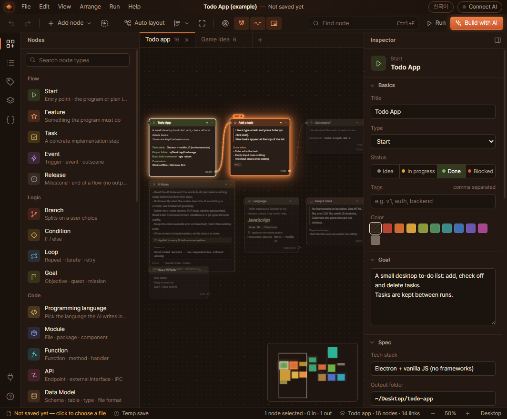
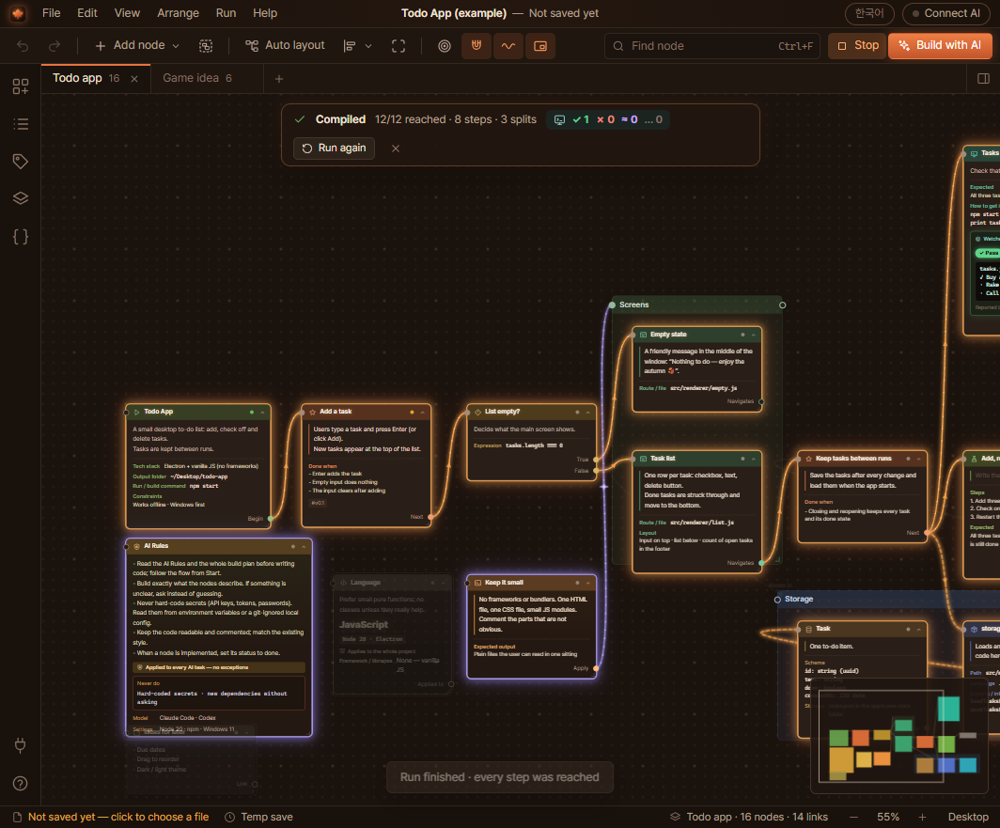
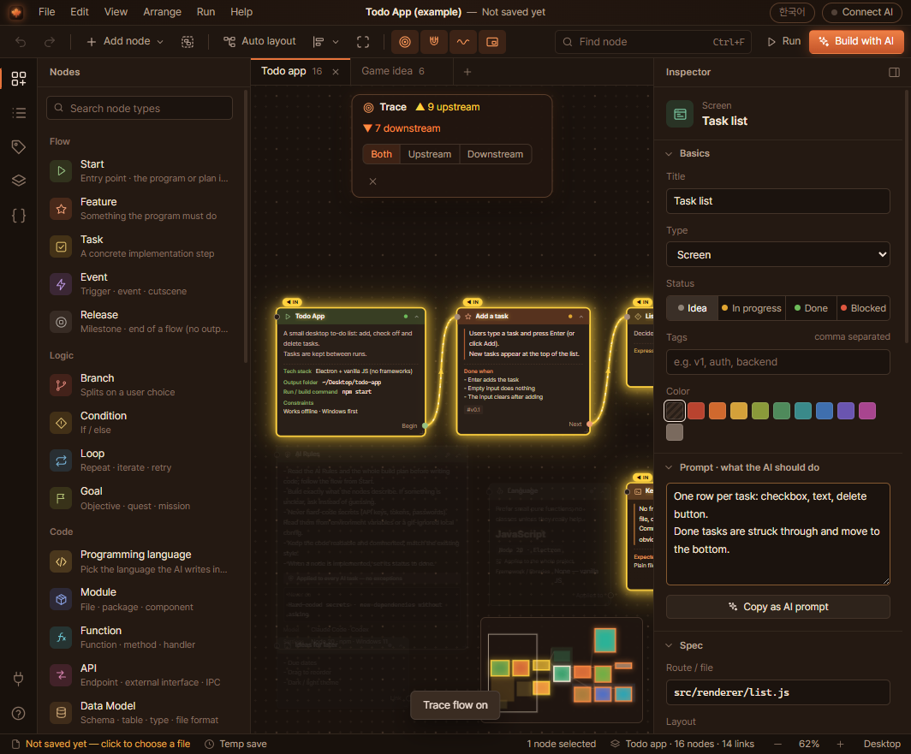
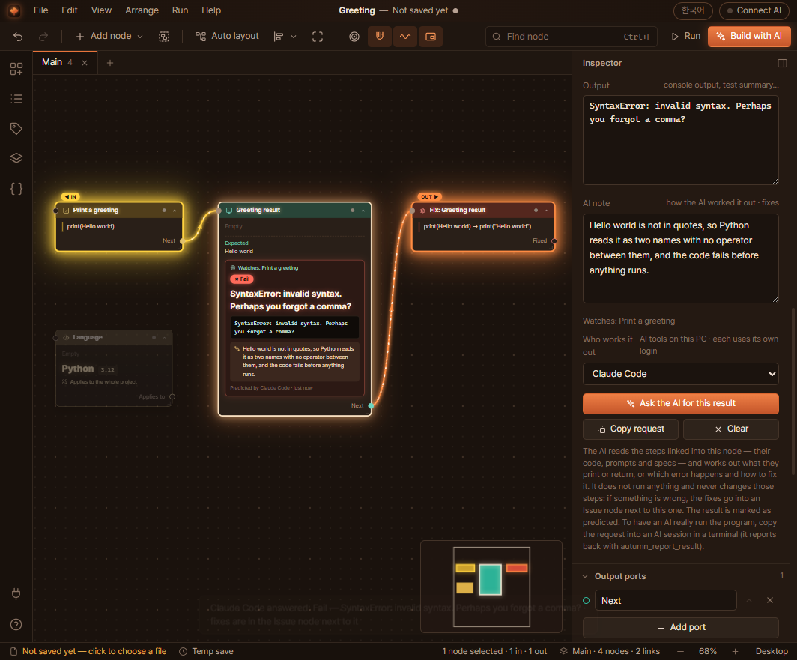
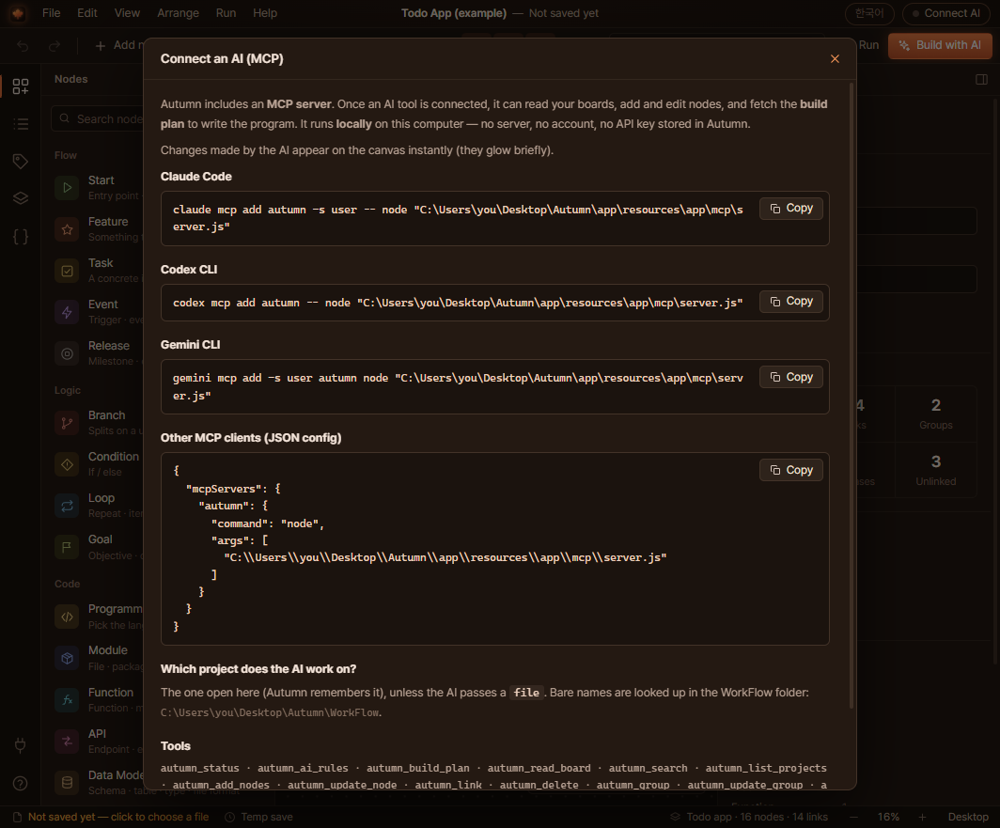

<p align="center">
  
</p>

<h1 align="center">Autumn IDE</h1>

<p align="center">
  A new kind of IDE: you design the program, the AI writes the code.<br>
  Lay out features, modules and screens as connected nodes. Claude Code, Codex or Gemini CLI read the plan over MCP and build it.
</p>

<p align="center">
  
  
  
  
</p>

<p align="center">
  <a href="https://github.com/PLUTOv4/autumn-ide/releases/latest/download/Autumn.exe"></a>
</p>

<p align="center">
  English | <a href="README.ko.md">한국어</a>
</p>



Autumn is an IDE built around the plan instead of the code. Each node is a piece of the program: a feature, a task, a module, a function, an API, a screen, a test. The text of a node is written as an instruction for the AI that will build it, and a few fields hold the details it has to respect, such as a file path, a function signature or a database schema. Links say what comes next, what depends on what, and which instructions apply where.

When the plan is ready, connect Claude Code, Codex CLI or Gemini CLI. The AI asks Autumn for the build plan, writes the code step by step, and marks each node as done. You see the nodes change on the canvas while it works.

Autumn runs entirely on your computer. There is no server and no account, and it never stores an API key. The AI tools you connect use their own sign-in.

## What you can do with it

- Plan with nodes for features, tasks, modules, functions, APIs, data models, screens, tests and issues. Story and game nodes (scenes, dialogue, characters, items) are there too.
- Write rules every AI has to follow in an **AI Rules** node, for example "never hard-code secrets". They are always the first thing in the build plan.
- Choose the programming language, version, frameworks and code style in a **Programming language** node. Leave it unlinked to use it for the whole project, or link it to the parts that use something else.
- Add a **Result** node as a check point and press *Ask the AI for this result*. The AI tool you pick reads the steps before it and fills in what they print or return. If something is wrong, it leaves those steps alone and writes the fix into an Issue node next to the result, for example `print(Hello world) → print("Hello world")`.
- Press **F11** to run the flow. A light moves from the Start node along the links, two seconds per step, and splits at every branch. Afterwards Autumn lists nodes that were never reached and branches that lead nowhere.
- Click a node to see what leads into it (gold) and what follows from it (orange). Press **T** to trace the whole chain.
- Copy the build plan, preview it, or export it as Markdown or PDF.
- Switch the interface between English and Korean.

Projects are plain JSON files (`*.autumn.json`) in the `WorkFlow` folder, so they are easy to back up or keep in git.

## Screenshots

| Run: the light goes through every branch | Trace: gold before the selection, orange after |
|---|---|
|  |  |
| **Result node with a fix in an Issue node** | **Connecting an AI tool** |
|  |  |

## Getting started

### Download

[Download Autumn.exe](https://github.com/PLUTOv4/autumn-ide/releases/latest/download/Autumn.exe) (Windows 10 or 11, 64-bit, about 155 MB) and run it. There is nothing to unzip or install.

- The first start takes a few seconds while Autumn unpacks itself into `%LOCALAPPDATA%\Autumn`. After that it starts right away.
- Projects are saved in `Documents\Autumn\WorkFlow`.
- Autumn starts in English. The button in the top right corner switches it to Korean.
- Windows SmartScreen may warn you the first time because the app is not code-signed. Choose *More info* and then *Run anyway*.

Earlier versions are on the [Releases](https://github.com/PLUTOv4/autumn-ide/releases) page.

### Build from source

You need Windows 10 or 11 (x64) and [Node.js](https://nodejs.org) 18 or newer.

1. Clone this repository.
2. Run `Build.bat`.

The build creates or updates a folder on your desktop:

```
Desktop\Autumn\
  Autumn.exe     start Autumn here
  WorkFlow\      your projects (*.autumn.json), never touched by a rebuild
  app\           the runtime (Electron)
```

The first build downloads Electron and the packaging tools into `%LOCALAPPDATA%\Autumn-build`. After that it works offline.

Other options:

- `node scripts/build.js --out=D:\Apps\Autumn` builds into another folder.
- `node scripts/build.js --lang=ko` makes Korean the starting language.
- `node scripts/build.js portable` makes the single `Autumn.exe` in `dist\`.
- `npm start` runs Autumn straight from the source.

## Connecting an AI tool

Click **Connect AI** in the top right corner of Autumn. It shows the exact commands for your machine, with the right paths filled in. They look like this:

<details>
<summary>Claude Code</summary>

```bash
claude mcp add autumn -s user -e ELECTRON_RUN_AS_NODE=1 -- "C:\Users\you\AppData\Local\Autumn\app\Autumn.exe" "C:\Users\you\AppData\Local\Autumn\app\resources\app\mcp\server.js"
```
</details>

<details>
<summary>Codex CLI</summary>

```bash
codex mcp add autumn --env ELECTRON_RUN_AS_NODE=1 -- "C:\Users\you\AppData\Local\Autumn\app\Autumn.exe" "C:\Users\you\AppData\Local\Autumn\app\resources\app\mcp\server.js"
```
</details>

<details>
<summary>Gemini CLI</summary>

```bash
gemini mcp add -s user -e ELECTRON_RUN_AS_NODE=1 autumn "C:\Users\you\AppData\Local\Autumn\app\Autumn.exe" "C:\Users\you\AppData\Local\Autumn\app\resources\app\mcp\server.js"
```
</details>

<details>
<summary>Other MCP clients (JSON)</summary>

```json
{
  "mcpServers": {
    "autumn": {
      "command": "C:\\Users\\you\\AppData\\Local\\Autumn\\app\\Autumn.exe",
      "args": ["C:\\Users\\you\\AppData\\Local\\Autumn\\app\\resources\\app\\mcp\\server.js"],
      "env": { "ELECTRON_RUN_AS_NODE": "1" }
    }
  }
}
```
</details>

These commands use Autumn's own runtime, so Node.js is not needed. If you built Autumn from source, the paths point to `Desktop\Autumn\app` instead.

Then open a terminal in the folder where the code should go and ask your AI, for example:

> Use the "autumn" MCP server. Call autumn_build_plan for the project "Todo App" and build the program it describes. Follow the AI Rules and set each node's status to "done" when it is finished.

**Build with AI** in the toolbar has this prompt ready to copy.

## How a plan turns into code

The AI does not look at the canvas. It reads a build plan that Autumn writes from your nodes:

1. The AI Rules come first, followed by the project settings from the Start node: goal, tech stack, output folder, run command, and the language from an unlinked Programming language node.
2. Starting at the Start node, Autumn follows flow, trigger and requires links and numbers the steps. Branches are listed with their port names, such as `[True]` and `[False]`.
3. Every step carries its prompt, its spec fields, its data, and whatever is linked to it: prompts and language nodes that apply to it, what it requires, what it uses, and what comes next. A link to a group counts for every node inside the group.
4. Modules, functions, APIs, data models and screens outside the flow are listed as components, so their paths and signatures are kept.
5. Result nodes appear as check points, together with their last result.

You can read the same text under **Build with AI → Preview plan**, and the AI gets it from `autumn_build_plan`.

## Result nodes

A Result node watches the steps linked into it. Pick which AI works it out (Claude Code, Codex or Gemini CLI, whichever is installed) and press **Ask the AI for this result**.

Autumn starts that tool once in its non-interactive mode and passes the question on standard input: `claude -p` with all tools turned off, `codex exec` in a read-only sandbox, or `gemini -p`. This is needed because MCP only lets an AI call Autumn, not the other way round. The answer usually arrives in 5 to 15 seconds and fills in the status (pass, fail or plain output), a one-line value, the output and a short reason. Nothing is executed, so the result is marked as predicted.

The steps before the Result node are never changed. If the result is wrong, the fix goes into an Issue node right next to it, one short line per change. Ask again after fixing the step: a passing result marks that issue as done, and a new failure reopens the same issue instead of adding another one.

To have a program really run, use *Copy request* and give it to an AI working in a terminal. It reports back with `autumn_report_result`, and its fixes end up in the same Issue node.

## MCP tools

| Tool | What it does |
|---|---|
| `autumn_status` | Project, boards, output folder, stack and the full AI Rules. The AI should call this first. |
| `autumn_ai_rules` | The AI Rules on their own |
| `autumn_build_plan` | The build plan described above, as Markdown |
| `autumn_read_board` | Every node, field, link, group and result on a board |
| `autumn_search` | Search titles, text and fields |
| `autumn_list_projects` | Projects in the WorkFlow folder |
| `autumn_add_nodes` | Add nodes; `after` and `port` link them to an existing node |
| `autumn_update_node` | Change title, prompt, type, status, fields or ports |
| `autumn_link` | Link nodes or groups |
| `autumn_delete` | Delete nodes, links or groups (deleting a group keeps its nodes) |
| `autumn_group` | Put nodes into a new group, optionally tidied into a block first |
| `autumn_update_group` | Rename or recolor a group, add or remove nodes, refit the frame |
| `autumn_duplicate_group` | Copy a group with its nodes and inner links |
| `autumn_report_result` | Fill in a Result node; fixes for a wrong result go into an Issue node |
| `autumn_set_data` | Structured data on a node (settings, constants, sample data) |
| `autumn_define_object` | Reusable data objects |
| `autumn_add_image` | Attach an image to a node, stored at full quality |
| `autumn_add_board` | Add a board |
| `autumn_new_project` | Create a project in the WorkFlow folder |
| `autumn_open` | Open a project in the app |
| `autumn_export` | Export the plan as Markdown or PDF |

## Node types

<details>
<summary>All 29 node types</summary>

| Node | Type | Used for |
|---|---|---|
| **Flow** | | |
| Start | `start` | Entry point; the program or plan itself |
| Feature | `feature` | Something the program must do |
| Task | `task` | A concrete implementation step |
| Event | `event` | Trigger, event, cutscene |
| Release | `ending` | Milestone; end of a flow |
| **Logic** | | |
| Branch | `choice` | Splits on a user choice |
| Condition | `condition` | If / else |
| Loop | `loop` | Repeat, iterate, retry |
| Goal | `quest` | Objective, quest, mission |
| **Code** | | |
| Programming language | `lang` | The language the AI writes in (unlinked means the whole project) |
| Module | `module` | File, package, component |
| Function | `function` | Function, method, handler |
| API | `api` | Endpoint, external interface, IPC |
| Data Model | `data` | Schema, table, type, file format |
| Screen | `ui` | Screen, page, dialog, view |
| Test | `test` | Test, acceptance check |
| Result | `result` | What the steps before it produce, filled in by the AI |
| Issue | `bug` | Bug or problem to fix |
| **Story and game** | | |
| Scene | `scene` | Scene, cut, stage |
| Dialogue | `dialogue` | Character lines, conversation |
| Character | `character` | Character, NPC, user persona |
| Location | `location` | Place, map, area |
| Item | `item` | Item, clue, key, asset |
| Lore | `lore` | World and background knowledge |
| **AI and notes** | | |
| Prompt | `prompt` | An instruction for the AI; link it to what it applies to |
| Doc | `doc` | Spec, requirements, reference file or URL |
| Note | `note` | Free-form note for people |
| AI Note | `ainote` | Model, prompt, settings and references |
| AI Rules | `aiguide` | Rules every AI follows in every task |

Links can be Flow, Triggers, Requires, Uses, Relation, Conflict, Ref or AI Ref. Run follows Flow, Triggers, Requires and Uses links.
</details>

## Keyboard shortcuts

| Key | Action |
|---|---|
| F11 or P | Run the flow (Esc stops) |
| T | Trace the flow of the selected node |
| Double-click | Add a node on empty canvas, or edit a node's title or prompt |
| Enter | Edit the selected node's prompt |
| Ctrl+N / Ctrl+O / Ctrl+S | New project (in WorkFlow), open, save |
| Ctrl+Z / Ctrl+Y | Undo, redo |
| Ctrl+C / Ctrl+V / Ctrl+D | Copy, paste, duplicate |
| Ctrl+G | Group the selected nodes |
| Ctrl+F | Find a node |
| F / 0 / L | Fit to screen, 100 %, auto layout |
| Ctrl+B / Ctrl+J | Side panel, inspector |
| F1 | All shortcuts |

## Project layout

```
src/         the editor, plain JavaScript without a framework
             app.js (UI), catalog.js (node types), fields.js (data), spec.js (build plan and PDF), styles.css
electron/    main process and preload: files, WorkFlow, PDF, AI tools for Result nodes
mcp/         the MCP server (stdio JSON-RPC, no dependencies): server.js, tools.js, model.js, rpc.js
launcher/    the small Autumn.exe launcher (C#, compiled with the compiler that comes with Windows)
i18n/        ko.json, the Korean translation, applied at build time by scripts/i18n.js
scripts/     build.js, i18n.js, make-manual.js, make-icon.js, test-mcp.js
docs/        screenshots and the Korean manual (manual-ko.html)
assets/      app icon
```

## Development

- `npm start` runs Autumn from the source.
- `npm test` starts the MCP server and runs it end to end in a temporary folder.
- UI text is written in English in `src/`. The Korean version is generated from `i18n/ko.json` when you build; `node scripts/i18n.js extract ko` lists text that has no translation yet.
- `node scripts/build.js manual` turns `docs/manual-ko.html` into a PDF.

See [CONTRIBUTING.md](CONTRIBUTING.md) before opening a pull request.

## Security and privacy

- Autumn does not connect to the internet and stores no keys or tokens.
- The MCP server only reads and writes Autumn projects and their images.
- Text from your nodes goes to an AI provider only through the AI tools you use yourself: when an AI reads the plan over MCP, or when you press *Ask the AI for this result*.
- New projects start with an AI rule that forbids hard-coding secrets.

Details and how to report a problem: [SECURITY.md](SECURITY.md).

## License

Autumn is released under the [PolyForm Noncommercial License 1.0.0](LICENSE). You may use, change and share it for any noncommercial purpose, such as personal projects, study, research and hobbies, and organizations like schools, charities and public institutions may use it too.

Commercial use, including selling Autumn or a product built on it, needs a separate license. Contact [PLUTOv4](https://github.com/PLUTOv4) to ask.

Autumn ships with the Pretendard font (SIL Open Font License 1.1), html-to-image (MIT) and Electron. They keep their own licenses; the full notices are in [THIRD_PARTY_NOTICES.md](THIRD_PARTY_NOTICES.md).
